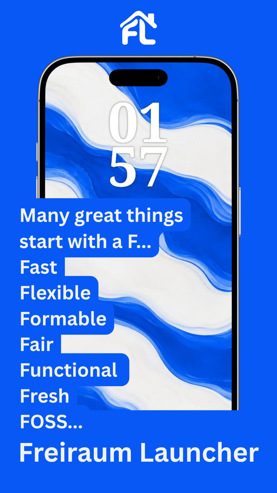
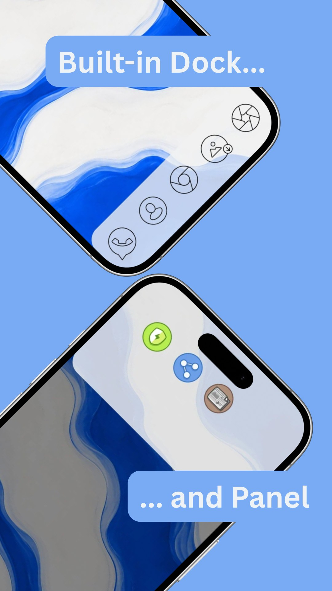
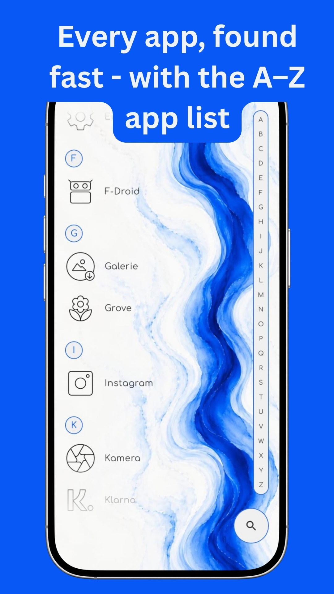
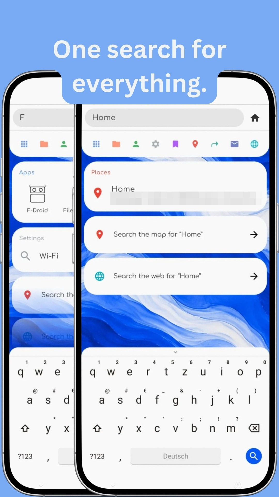
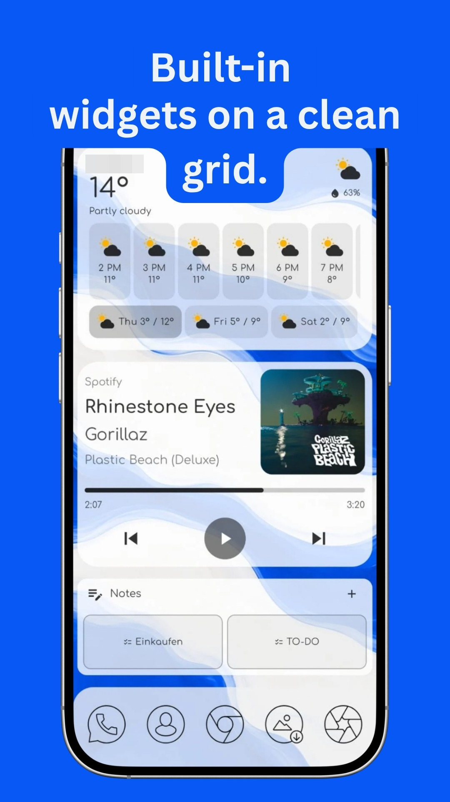
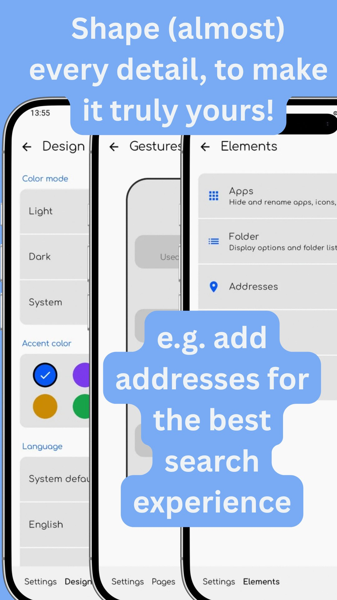
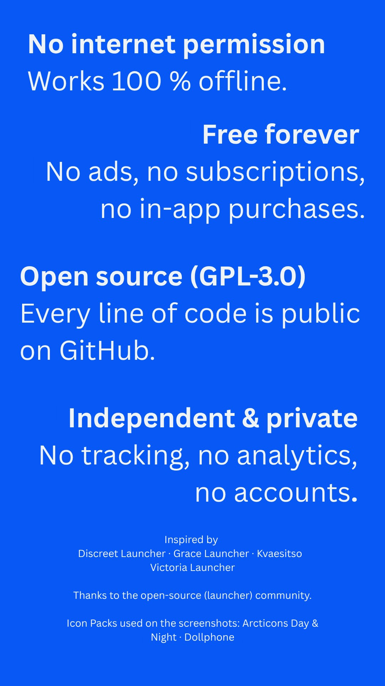
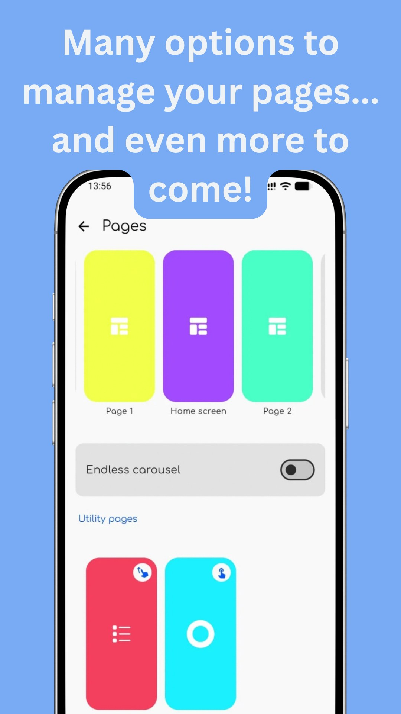
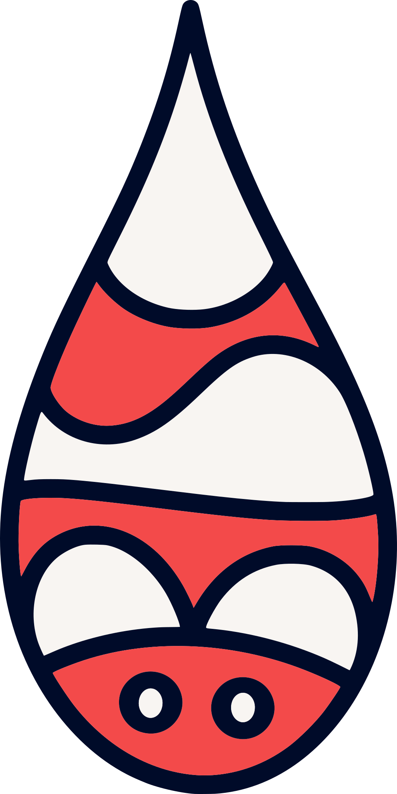

# Freiraum Launcher

A calm Android home screen that you arrange exactly the way you want. No internet permission, no
tracking, no proprietary libraries. Nothing leaves your phone.

       

## Features

### Pages
- A home page plus as many pages as you like, each with its own background; optionally an endless
  carousel
- Pages are built from rows: element boxes and widgets on a tidy row grid
- A Dock at the bottom and a pull-down Panel at the top, shown on every page
- Function pages: App list, App grid, Text search and Categories

### Elements
Everything you can tap is an element: set it up once, then place it anywhere (Dock, Panel, element
boxes, folders).
- Apps, folders, places, links, contacts, shortcuts and action buttons
- "Add to home screen" from other apps, for example a website from the browser
- **Categories**: sort apps and other elements, one app can be in several
  - ready-made from what Android knows about an app (games, music, photos and more)
  - smart categories that fill themselves: newly installed, not used in a while, used often,
    without category, or your own rule (name contains, kind by Android, work and private apps)
  - their own page with chips, cards, tabs or a list; as filters in the App list; in the text search
  - folders can follow a category and fill themselves

### Widgets
- Clock, notes, music, weather, categories and empty space, plus regular Android widgets
- Widgets with several pages switch by swiping or with paging buttons
- Weather comes from a weather app that provides it (Breezy Weather via Gadgetbridge); Freiraum
  itself never goes online

### App list, App grid and search
- Alphabetical App list with a fast A–Z rail; App grid with its own search field
- Text search across apps, favorites, folders, contacts, system and launcher settings, shortcuts,
  links, places and categories, with calculator, unit converter, web, maps and AI app commands
- Rename apps, hide them from the list or search, or reveal them only with a search code
- Work profile and private space apps in their own section

### Look and feel
- Light and dark mode, accent color, corner shapes, icon packs and themed icons (Android 13+)
- Fill, border and text color for every part, with live previews
- **Designs**: ready-made looks with colors, borders and effects (Neon, 3D), see
  [designs](designs/README.md)
- **Wallpapers**: a picture for every page and the lock screen, see
  [wallpapers](wallpaper-packs/README.md)
- Keyboard bezel: a strip over the keyboard in a color of your choice
- Charging animation
- Seven gestures (swipe, double tap, long press, two fingers up and down, pinch), each assignable

### Accessibility and privacy
- Accessibility mode: solid elements with strong borders, larger icons and text, no motion effects
- Settings lock: the settings open only after your screen lock (fingerprint, face, PIN, pattern or
  password)
- Keyboard does not learn: asks the keyboard not to remember what you type into searches
- Backup: export and import everything as one file

### Tablets
Held sideways, pages show their rows in two columns, and the App list and search use the extra width.

Languages: English, German.

## Permissions

All optional ones are asked for only when you use the feature.

| Permission | Why |
|---|---|
| `READ_CONTACTS` (optional) | Find and place contacts |
| Notification access (optional) | Control music playback in the music widget; notification content is not read |
| `EXPAND_STATUS_BAR` | Gestures that open the notifications or quick settings |
| `SET_WALLPAPER` | Put a wallpaper's picture on the lock screen, only when you ask for it |
| `REQUEST_DELETE_PACKAGES` | Uninstall an app from its menu; Android asks you to confirm |
| `ACCESS_HIDDEN_PROFILES` | Show the apps of your private space (Android 15+) |
| `USE_BIOMETRIC` | Unlock the settings with your fingerprint or face |

There is no `INTERNET` permission. Anything online (web search, maps, weather) is handed to another
app.

## Download

Get the APK from the [releases page](https://github.com/BISCLab/freiraum-launcher/releases). Designs
and wallpaper packs are attached to each release. F-Droid is coming soon.

## Inspired by

Discreet Launcher · Grace Launcher · Kvaesitso · Victoria Launcher

Thanks to the open-source launcher community. Icon packs shown in the screenshots: Arcticons Day &
Night and Dollphone.

## License

Freiraum Launcher is licensed under the [GNU General Public License v3.0 or later](LICENSE).
Bundled fonts are under the SIL Open Font License 1.1, see
[THIRD_PARTY_LICENSES.md](THIRD_PARTY_LICENSES.md).

---

 
<b>BISC Lab</b>

