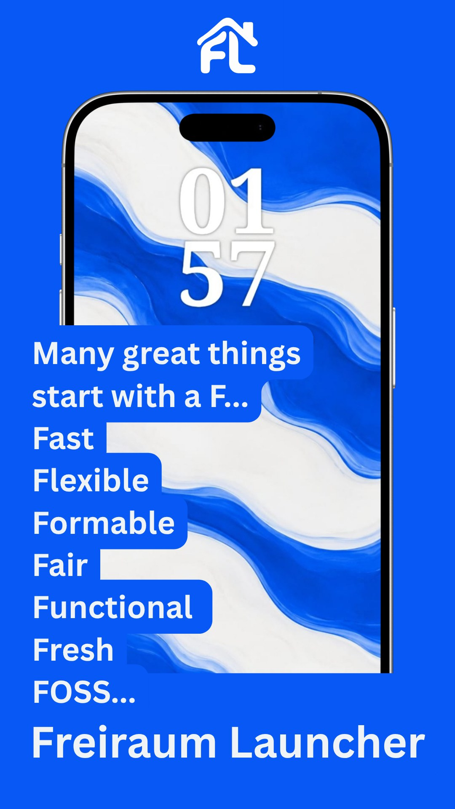
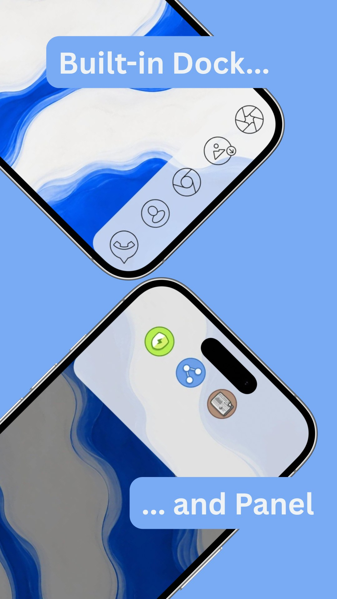
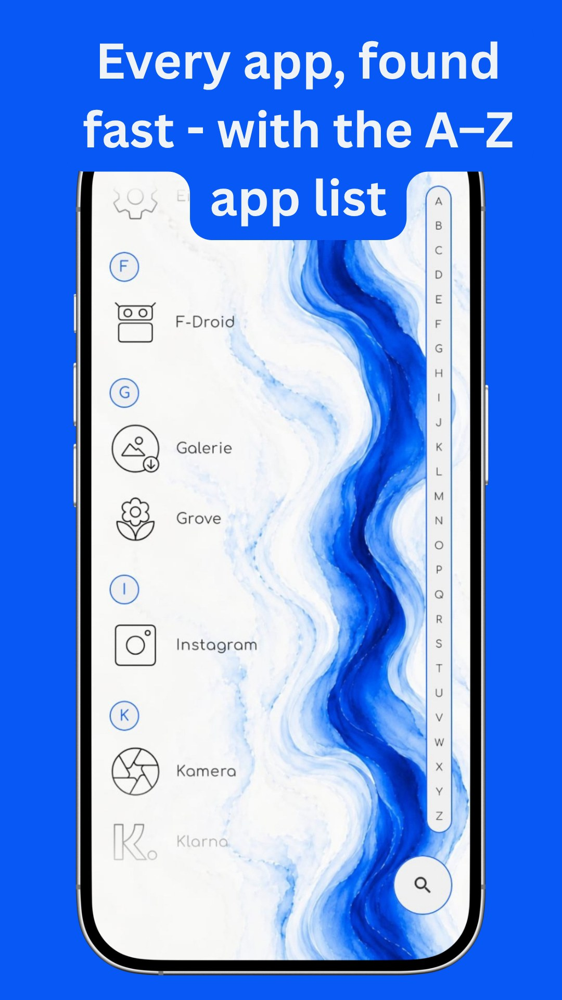
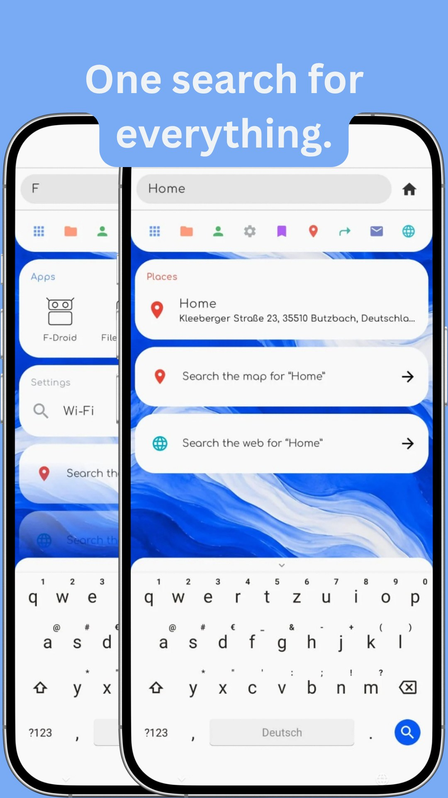
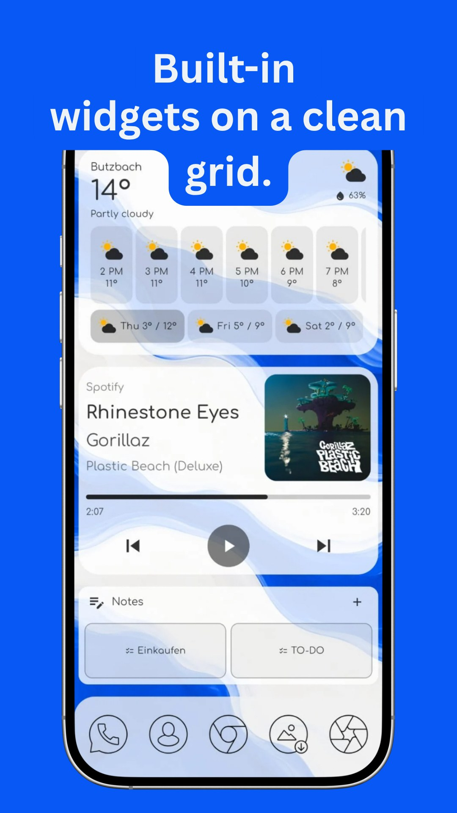
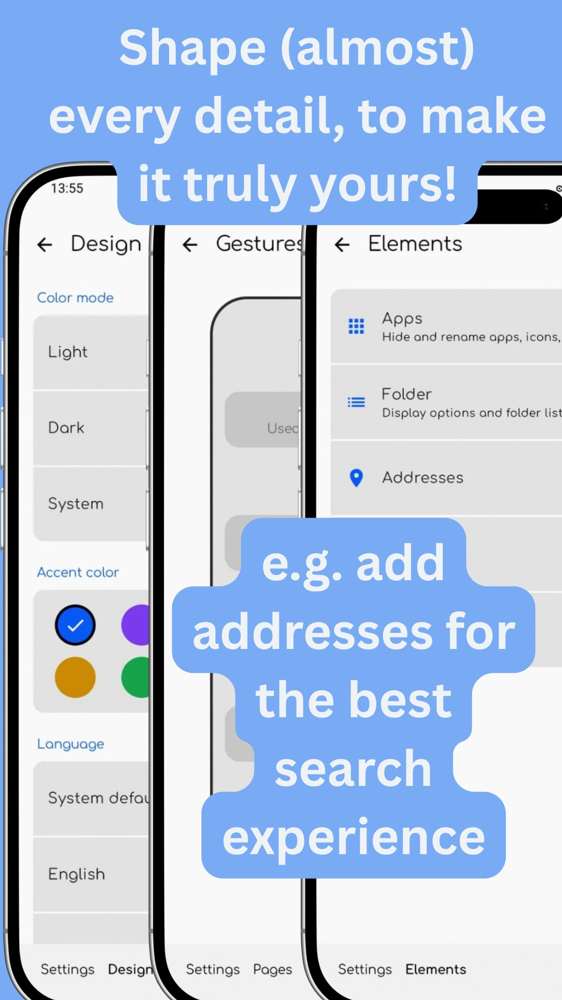
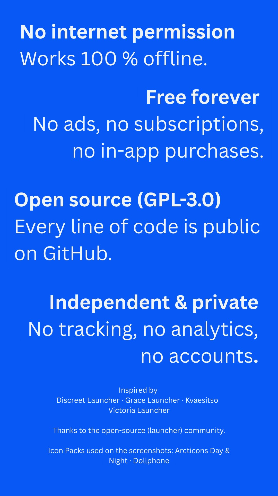
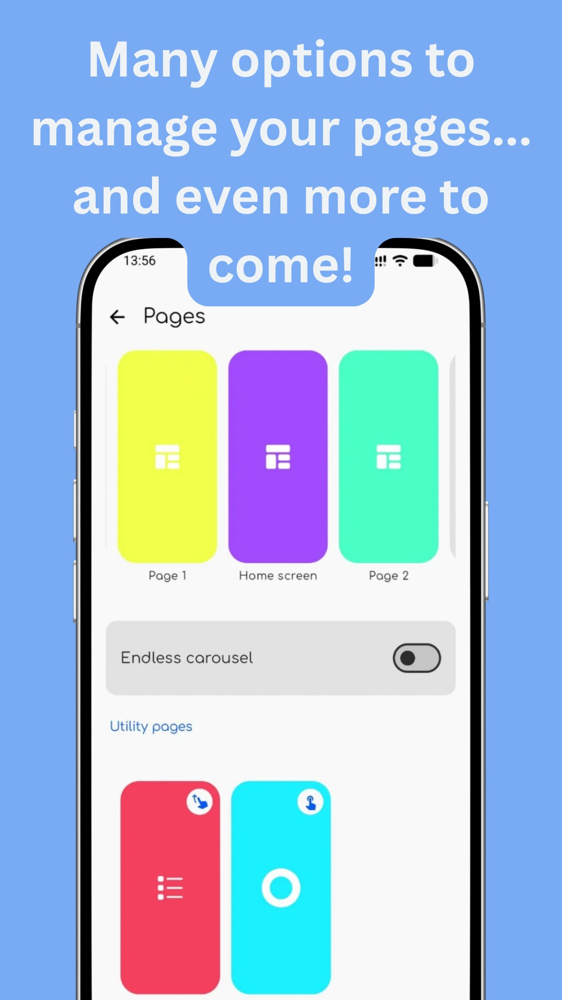

# Freiraum Launcher

A calm, customizable Android home screen. No internet permission, no tracking, no proprietary
libraries.

<p>
       
</p>

## Features

- **Pages** – a home page plus extra pages, each with its own background, built from rows of apps,
  folders, contacts, addresses, links, shortcuts and action buttons on a row grid; optionally an
  endless carousel
- **Widgets** – clock, music, weather (Gadgetbridge weather format), notes and spacers, plus regular
  Android app widgets
- **Dock and Panel** – a dock at the bottom and a pull-down panel at the top, both with fixed slots
  and shown on every page
- **Folders** – apps, links, contacts and widgets (including Android app widgets)
- **App list** – alphabetical, with a fast-scroll A–Z index; apps can be renamed, hidden from the
  list or search, or revealed only by a search code
- **Text search** – apps, folders, contacts, settings, shortcuts, links and addresses, with web,
  maps, e-mail and calculator commands
- **Appearance** – light/dark mode, accent color, corner shapes, icon packs, and fill, border and
  text color for every element
- **Gestures** – swipe up/down, double tap and long press, each assignable
- **Backup** – export and import everything as one file

Languages: English, German.

## Permissions

| Permission | Why |
|---|---|
| `READ_CONTACTS` (optional) | Find and pin contacts |
| Notification access (optional) | Control music playback in the music widget; notification content is not read |
| `EXPAND_STATUS_BAR` | Gesture that opens the notification shade |

## Building

Requirements: JDK 17 and the Android SDK (compileSdk 35).

```sh
./gradlew assembleRelease   # release APK in app/build/outputs/apk/release/
./gradlew assembleDebug     # debug APK
```

The release build is unsigned unless a `keystore.properties` file exists in the project root
(never commit it):

```properties
storeFile=/path/to/release.jks
storePassword=…
keyAlias=…
keyPassword=…
```

F-Droid builds and signs the app itself, so it ignores this file.

## Releasing

1. Bump `versionCode` and `versionName` in `app/build.gradle.kts`.
2. Add `fastlane/metadata/android/<locale>/changelogs/<versionCode>.txt` for each locale.
3. Commit and tag the release as `v<versionName>`, e.g. `v0.2.0`.

Store texts and screenshots live in `fastlane/metadata/android/` (screenshots go in
`images/phoneScreenshots/`).

## Inspired by

Discreet Launcher · Grace Launcher · Kvaesitso · Victoria Launcher

Thanks to the open-source launcher community. Icon packs shown in the screenshots: Arcticons Day &
Night and Dollphone.

## License

Freiraum Launcher is licensed under the [GNU General Public License v3.0](LICENSE).
Bundled fonts are under the SIL Open Font License 1.1, see
[THIRD_PARTY_LICENSES.md](THIRD_PARTY_LICENSES.md).

---

<p align="center">
<br>
<b>BISC Lab</b>
</p>
